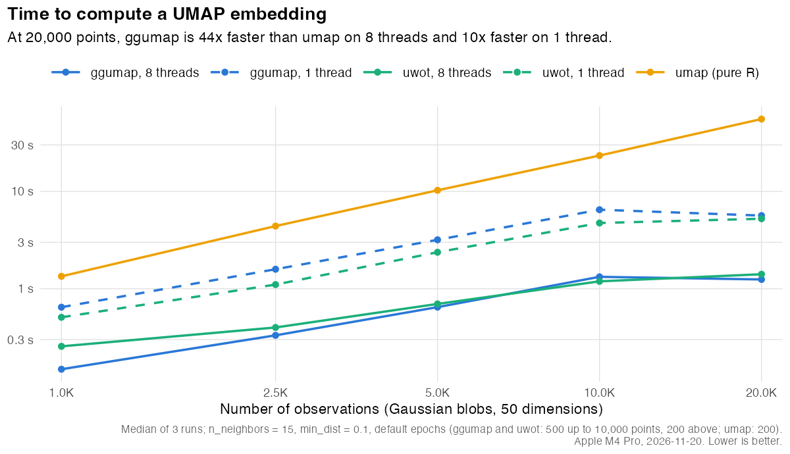

[ggumap](https://ggumap.jeroenjanssens.com) computes UMAP embeddings *inside* a
ggplot2 layer. This document shows what changes compared to the usual
workflow, using the same MNIST data as `01-mnist.ipynb`: every row is a 28 × 28
grayscale image of a handwritten digit, flattened to 784 pixel columns.

```{r}
#| label: setup
#| cache: false
# install.packages("pak")
# pak::pak("jeroenjanssens/ggumap")  # needs a Rust toolchain to build
library(ggplot2)
library(ggumap)

theme_set(theme_minimal(base_size = 11))
```

## The data

The data is downloaded once and cached in `~/.cache/positron-atlas/datasets`,
shared with the Python notebooks in this folder.

```{r}
#| label: data
cache_dir <- file.path(path.expand("~"), ".cache", "positron-atlas", "datasets")
base_url <- "https://ossci-datasets.s3.amazonaws.com/mnist/"

download <- function(name) {
  path <- file.path(cache_dir, paste0("mnist-", name))
  if (!file.exists(path)) {
    dir.create(cache_dir, recursive = TRUE, showWarnings = FALSE)
    utils::download.file(paste0(base_url, name), path, mode = "wb")
  }
  path
}

# The IDX format: a big-endian header, followed by unsigned bytes.
read_idx <- function(path) {
  con <- gzfile(path, "rb")
  on.exit(close(con))
  magic <- readBin(con, "integer", n = 1, size = 4, endian = "big")
  dims <- readBin(con, "integer", n = magic %% 256, size = 4, endian = "big")
  values <- readBin(con, "integer", n = prod(dims), size = 1, signed = FALSE)
  if (length(dims) == 1) values else matrix(values, nrow = dims[1], byrow = TRUE)
}

pixels <- rbind(
  read_idx(download("train-images-idx3-ubyte.gz")),
  read_idx(download("t10k-images-idx3-ubyte.gz"))
)
labels <- c(
  read_idx(download("train-labels-idx1-ubyte.gz")),
  read_idx(download("t10k-labels-idx1-ubyte.gz"))
)

mnist <- as.data.frame(pixels / 255)
names(mnist) <- paste0("px", seq_len(ncol(mnist)) - 1)
mnist$label <- factor(labels, levels = 0:9)
mnist$split <- ifelse(seq_along(labels) <= 60000, "train", "test")
dim(mnist)
```

MNIST has ten digits, more than colour can tell apart reliably. The plots
below colour the digits 3, 5 and 8, which are easily confused, and show the
others in grey.

```{r}
#| label: highlight
mnist$digit <- factor(
  ifelse(mnist$label %in% c("3", "5", "8"), as.character(mnist$label), "other"),
  levels = c("3", "5", "8", "other")
)
digit_colours <- c(`3` = "#2a78d6", `5` = "#eb6834", `8` = "#1baf7a", other = "grey80")

# A random sample of 10,000 digits, small enough for the umap package.
set.seed(1)
digits <- mnist[sample(nrow(mnist), 10000), ]
```

## Before: compute, bind, plot

Without ggumap, a UMAP plot takes three steps. You compute the embedding with a
package such as [umap](https://cran.r-project.org/package=umap), bind its
coordinates back to the data, and only then plot:

```{r}
#| label: before
#| fig-alt: "UMAP embedding of 10,000 MNIST digits computed with the umap package; the digits 3, 5 and 8 are coloured."
library(umap)

before <- system.time({
  # 1. Compute the embedding from the pixel columns
  pixel_cols <- grep("^px", names(digits))
  fit <- umap(as.matrix(digits[pixel_cols]), random_state = 42)

  # 2. Bind the coordinates back to the data (and hope the rows still line up)
  embedded <- cbind(digits, UMAP1 = fit$layout[, 1], UMAP2 = fit$layout[, 2])
})

# 3. Plot
ggplot(embedded, aes(UMAP1, UMAP2, colour = digit)) +
  geom_point(size = 0.4) +
  scale_colour_manual(values = digit_colours) +
  guides(colour = guide_legend(override.aes = list(size = 3)))
```

```{r}
#| label: before-time
before[["elapsed"]]
```

Every change to the data means repeating the first two steps. Filtering rows
before step 2 misaligns them. A second view, such as a facet or a layer of
labels, needs the bound data frame too.

## After: one layer

With ggumap, the embedding is part of the plot. `geom_umap()` uses the columns
selected with `features`, here all pixel columns. Aesthetics such as `colour`
are carried along row by row, but don't change the embedding:

```{r}
#| label: after
#| fig-alt: "The same 10,000 digits embedded with geom_umap(); the digits 3, 5 and 8 are coloured."
after <- system.time({
  p <- ggplot(digits, aes(colour = digit)) +
    geom_umap(features = starts_with("px"), size = 0.4, seed = 42) +
    scale_colour_manual(values = digit_colours) +
    guides(colour = guide_legend(override.aes = list(size = 3))) +
    theme_umap()
  print(p)
})
```

```{r}
#| label: after-time
after[["elapsed"]]
```

This includes drawing the plot. The result is cached, so printing, resizing or
saving the plot again doesn't recompute the embedding.

## All 70,000 digits

ggumap is fast enough for the whole data set:

```{r}
#| label: full
#| fig-alt: "UMAP embedding of all 70,000 MNIST digits; the digits 3, 5 and 8 are coloured."
full <- system.time({
  p_full <- ggplot(mnist, aes(colour = digit)) +
    geom_umap(features = starts_with("px"), size = 0.1, alpha = 0.5, seed = 42) +
    scale_colour_manual(values = digit_colours) +
    guides(colour = guide_legend(override.aes = list(size = 3, alpha = 1))) +
    theme_umap()
  print(p_full)
})
full[["elapsed"]]
```

## One embedding, many views

Layers and facets share one embedding. Faceting by digit shows where each of
the ten digits ends up, without needing ten colours:

```{r}
#| label: facets
#| fig-height: 5.5
#| fig-alt: "Small multiples of the UMAP embedding, one panel per digit, with the digit in black on top of all digits in grey."
ggplot(digits) +
  geom_umap(
    data = transform(digits, label = NULL),
    features = starts_with("px"), colour = "grey85", size = 0.2, seed = 42
  ) +
  geom_umap(features = starts_with("px"), size = 0.2, seed = 42) +
  facet_wrap(vars(label), nrow = 2) +
  theme_umap()
```

The grey layer drops the `label` column, so it shows all digits in every panel.
Both layers embed the same pixels with the same settings, so ggumap computes
the embedding once.

Geoms that draw one mark per row, such as `"text"` or `"label"`, work with
`stat_umap()` too. Geoms with their own statistic, such as densities, can't be
combined with it, because ggplot2 runs one statistic per layer. For those,
compute the coordinates with `umap_embed()`, which returns them as a data
frame, and use the regular geom. With the same data and settings, this reuses
the cached embedding:

```{r}
#| label: density
#| fig-height: 3.5
#| fig-alt: "Filled density contours of the embedding, for the train and test split side by side."
emb <- cbind(digits, umap_embed(digits, starts_with("px"), seed = 42))
ggplot(emb, aes(UMAP1, UMAP2)) +
  geom_density_2d_filled(contour_var = "ndensity") +
  facet_wrap(vars(split)) +
  theme_umap() +
  theme(legend.position = "none")
```

And the computed variable `knn_dist`, the mean distance of each digit to its
nearest neighbours in pixel space, points at unusual digits. Darker points
are farther from their neighbours:

```{r}
#| label: knn-dist
#| fig-alt: "The embedding coloured by the mean distance to the nearest neighbours in pixel space; darker points are more unusual."
ggplot(digits) +
  geom_umap(
    aes(colour = after_stat(knn_dist)),
    features = starts_with("px"), size = 0.4, seed = 42
  ) +
  scale_colour_viridis_c(option = "mako", direction = -1) +
  theme_umap()
```

## Benchmark

ggumap is much faster than the [umap](https://cran.r-project.org/package=umap)
package, and on par with [uwot](https://cran.r-project.org/package=uwot):

{fig-alt="Line chart of the time to compute a UMAP embedding with ggumap, uwot and umap, for 1,000 to 20,000 observations."}

```{r}
#| label: benchmark-table
#| echo: false
#| cache: false
res <- read.csv("assets/ggumap-benchmark.csv")
res <- res[res$n == max(res$n), ]
res$implementation <- ifelse(
  res$contender == "umap-naive",
  "umap (pure R)",
  paste0(
    sub("-0.5", "", res$contender), ", ", res$threads,
    ifelse(res$threads == 1, " thread", " threads")
  )
)
tab <- aggregate(cbind(seconds, trustworthiness) ~ implementation, res, stats::median)
tab <- tab[order(tab$seconds), ]
knitr::kable(
  tab,
  row.names = FALSE,
  digits = c(0, 1, 3),
  col.names = c("Implementation", "Seconds", "Trustworthiness"),
  caption = sprintf(
    "%s observations, median of %d runs.",
    format(max(res$n), big.mark = ","), max(res$rep)
  )
)
```

All three find embeddings of the same quality (trustworthiness measures how
well the embedding preserves the nearest neighbours of the input). With one
thread, uwot is somewhat faster than ggumap's default `flavour = "0.5"`; the
`flavour = "0.6"` pipeline was two to three times as fast as the default at
10,000 observations. See
[`bench/`](https://github.com/jeroenjanssens/ggumap/tree/main/bench) for the
methodology.
